# crawlerr: Distributed Socket-Level Telemetry & Web Harvester

[](https://www.python.org/)
[](https://datatracker.ietf.org/doc/html/rfc5321)
[](https://github.com/hemal9102/crawlerr)

A zero-dependency distributed web crawler, raw MX DNS resolver, and RFC 5321 socket-level verification pipeline. Engineered with zero external package bloat (`no requests`, `no beautifulsoup`, `no scrapy`) to maximize raw socket throughput, eliminate dependency-induced latency, and provide deterministic runtime execution.

---

## Architecture & Systems Overview

`crawlerr` unifies two decoupled subsystems: an in-memory zero-dependency BFS web crawler and an asynchronous direct socket RFC 5321 verification engine with active anti-catchall detection.

```mermaid
flowchart TD
    subgraph CrawlerCore["Subsystem 1: In-Memory Zero-Dependency Web Harvester"]
        Seed["Target Host Seed (URL)"]
        Queue["FIFO Traversal Queue (collections.deque - O(1))"]
        Dedup["Cryptographic Barrier (SHA-256 Digest + set() - O(1))"]
        Parser["Linear Stream Tokenizer (html.parser.HTMLParser - O(L))"]
        EntityStore["Entity Graph / Clean Dataset"]

        Seed --> Queue
        Queue -->|"Pop Next URL"| Dedup
        Dedup -->|"Unique Entity"| Parser
        Parser -->|"Extract Links and Text"| Queue
        Parser -->|"Commit Indexed Node"| EntityStore
    end

    subgraph MailopsTelemetry["Subsystem 2: RFC 5321 Socket Telemetry & Mailops Verifier"]
        Candidate["Candidate Email Target (e.g. user@domain.com)"]
        SyntaxFilter["Strict Syntax RFC 5322 RegEx & Disposable Domain Filter"]
        DNSResolver["Primary MX DNS Resolver (OS socket / dnspython fallback)"]
        
        subgraph SMTPHandshake["Direct SMTP Socket Handshake (:25)"]
            Connect["TCP Socket Connect (timeout=10s)"]
            Banner["Read Server Banner (220)"]
            Helo["EHLO / HELO Handshake (tensix.in)"]
            MailFrom["MAIL FROM: <telemetry@tensix.in>"]
            CatchAllProbe["Anti-Catchall Probe: RCPT TO <random_uuid_trap@domain.com>"]
            TargetProbe["Target Probe: RCPT TO <user@domain.com>"]
        end

        Ledger["Autonomous Dispatch Ledger (JSON)"]
        Shield["Reputation Shield (Rate Limiter / Exponential Backoff)"]

        Candidate --> SyntaxFilter
        SyntaxFilter -->|"Valid Syntax"| DNSResolver
        DNSResolver --> Connect
        Connect --> Banner --> Helo --> MailFrom
        MailFrom --> CatchAllProbe
        CatchAllProbe -->|"Returns 250 - Catch-All Detected"| Shield
        CatchAllProbe -->|"Returns 550 - Strict Bounce Filter Active"| TargetProbe
        TargetProbe -->|"250 OK - Deliverable"| Ledger
        TargetProbe -->|"550 or Timeout - Rejected"| Shield
    end
```



---

## Technical Specifications & Engineering Primitives

### 1. Zero-Dependency DSA Foundation (`crawler.py`)
- **Traversal Queue**: `collections.deque` provides **O(1)** push and pop operations for breadth-first search (BFS) graph discovery with zero list reallocation overhead.
- **Idempotency Barrier**: Combines `hashlib.sha256` digest hashing with memory-efficient hash sets (`set()`) for **O(1)** duplication rejection.
- **Native Parser**: Uses standard library `html.parser.HTMLParser` as a streaming linear tokenizer (O(L)) requiring zero C-extension compilation.

### 2. RFC 5321 Direct Socket Verification (`smtp_rcpt_verifier.py`)
- **Direct Mailbox RCPT Interrogation**: Resolves MX records via raw OS socket layers and executes multi-stage SMTP handshakes (`HELO` -> `MAIL FROM` -> `RCPT TO`) directly against destination mail servers.
- **Anti-Catchall Probe Defense**: Actively probes domains using randomized non-existent mailbox strings to detect catch-all traps, discarding false-positive `250 OK` replies to ensure zero hard bounce risk.
- **Disposable Domain Blacklist**: Fast memory set lookup blocking temporary and high-risk domains prior to socket initialization.

### 3. Mailops Reputation Shield (`reputation_shield.py`)
- **Per-Domain Rate Limiting**: Enforces strict pacing and exponential backoff to avoid IP throttling across major providers (Google Workspace, Microsoft 365, Proton).
- **Audit Logging**: Persists real-time socket codes and MX latency metrics to structured JSON logs.

---

## Directory Organization

```text
crawlerr/
├── crawler.py                     # Zero-dependency BFS crawler and state machine tokenizer
├── smtp_rcpt_verifier.py          # RFC 5321 direct socket verification & anti-catchall detector
├── reputation_shield.py           # Rate-limiting, backoff heuristics, and telemetry tracker
├── master_engine.py               # Multi-threaded orchestrator and queue coordinator
├── mailops_scorer.py              # Domain deliverability and reputation scoring algorithm
└── yc_batch_crawler.py            # Automated entity extraction pipeline
```

---

## Quickstart

### 1. Run the Harvester (Zero External Dependencies)
```bash
# Default seed
python crawler.py

# Custom target
python crawler.py "https://news.ycombinator.com"
```

### 2. Run Direct Socket Verification
```bash
# Verify active mailbox deliverability and catch-all state
python smtp_rcpt_verifier.py
```

---

## Author
**Hemal Shah**  
Author: [IETF Internet-Draft `draft-shah-agent-readiness-evaluation-00`](https://www.ietf.org/archive/id/draft-shah-agent-readiness-evaluation-00.html)  
Systems & AI Platform Engineer | Founder & Systems Architect at [TENSIX](https://tensix.in)
